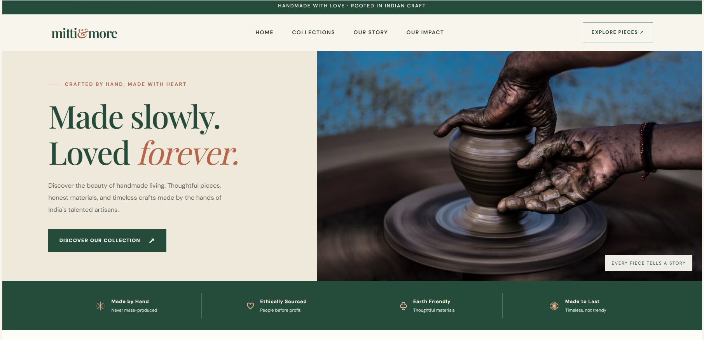
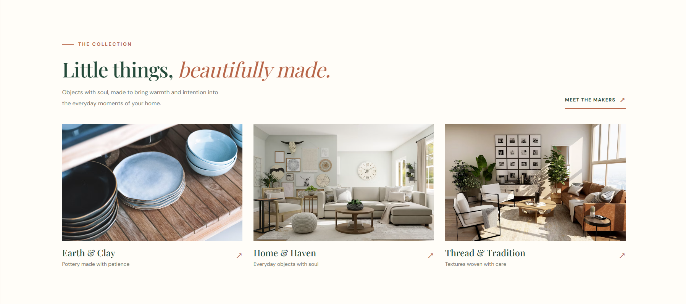
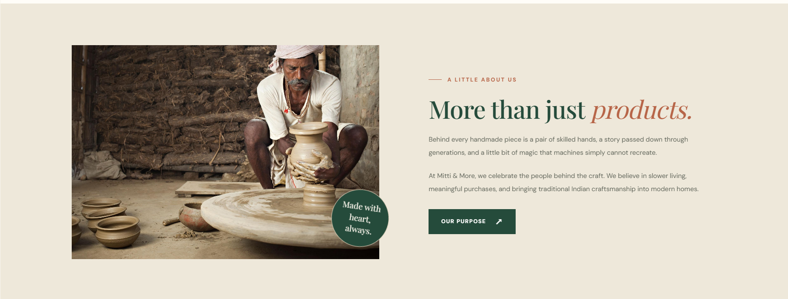
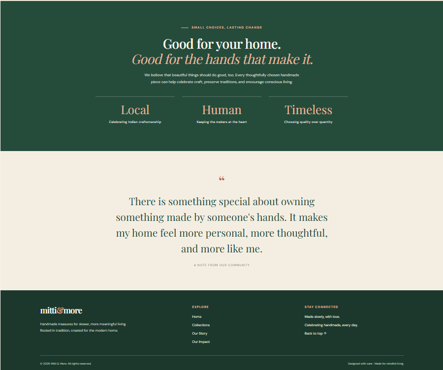

# Mitti & More
### Made Slowly. Loved Forever.

<p align="center">
  <strong>A digital storefront concept celebrating the beauty of handmade living.</strong>
  <br />
  Pottery · Textiles · Homeware · Indian Craftsmanship
</p>

---

## The Idea Behind the Project

**Mitti & More** is a handcrafted lifestyle brand concept designed to bring traditional artistry into a modern digital experience.

The landing page introduces a curated collection of handmade pottery, home accessories, and textiles. Its visual identity is inspired by natural materials, earthy colours, thoughtful craftsmanship, and the philosophy of mindful living.

Rather than following a conventional e-commerce template, the experience focuses on storytelling, visual presentation, and creating a distinct brand identity.

## Visual Direction

| Design Element | Direction |
|---|---|
| Brand personality | Minimal, warm, artisanal |
| Primary palette | Earthy green, cream, terracotta |
| Typography | Playfair Display & DM Sans |
| Visual language | Clean layouts and generous spacing |
| Overall aesthetic | Contemporary meets traditional |

## Visual Preview

<p align="center">
  
  <br>
  <em>01 — First impressions: the brand's visual identity.</em>
</p>

<p align="center">
  
  <br>
  <em>02 — Three curated collections inspired by handmade living.</em>
</p>

<p align="center">
  
  <br>
  <em>03 — The story and values behind the brand.</em>
</p>

<p align="center">
  
  <br>
  <em>04 — Navigation and closing details.</em>
</p>

## Inside the Experience

### 01 — Brand Introduction
A welcoming hero section introduces the brand and communicates its handmade philosophy.

### 02 — Curated Collections
Three distinct collection categories organize the brand's offerings:

- **Earth & Clay** — Celebrating pottery and ceramic craftsmanship.
- **Home & Haven** — Thoughtfully selected homeware.
- **Thread & Tradition** — Inspired by textiles and traditional artistry.

### 03 — Brand Story & Information
Dedicated informational sections communicate the brand's identity, values, and approach to mindful living.

### 04 — Navigation & Footer
Internal navigation links connect important page sections, while the footer provides additional navigation and brand information.

## Technology Stack

<p>
  <strong>HTML5</strong> · <strong>CSS3</strong> · <strong>Google Fonts</strong>
</p>

| Technology | Purpose |
|---|---|
| HTML5 | Semantic page structure and content |
| CSS3 | Visual styling, layout, and presentation |
| Google Fonts | DM Sans and Playfair Display typography |

## Project Architecture

```text
WebDev-L1-LandingPage/
│
├── index.html       # Main landing page
├── style.css        # Stylesheet
└── README.md        # Project documentation
```

## Run Locally

No framework installation or build process is required.

1. Clone the repository:

   ```bash
   git clone https://github.com/asthasingh18/OIBSIP.git
   ```

2. Navigate to the project directory:

   ```bash
   cd OIBSIP/WebDev-L1-LandingPage
   ```

3. Open `index.html` in your preferred web browser.

## What This Project Explores

Through this project, I explored:

- Structuring a multi-section landing page using HTML.
- Applying CSS styling to establish a consistent visual identity.
- Using typography and colour to communicate brand personality.
- Organizing content into meaningful sections.
- Creating clear internal navigation.
- Translating a brand concept into a browser-based experience.

## Internship Context

| Detail | Information |
|---|---|
| Organization | Oasis Infobyte |
| Internship Track | Web Development & Design |
| Internship Level | Level 1 |
| Assigned Task | Landing Page |
| Project | Mitti & More |

## Project Repository

**GitHub:** [OIBSIP — Web Development & Design Internship](https://github.com/asthasingh18/OIBSIP)

---

<p align="center">
  <strong>Crafted with intention. Inspired by tradition.</strong>
  <br />
  <em>Mitti & More — Made Slowly, Loved Forever.</em>
</p>