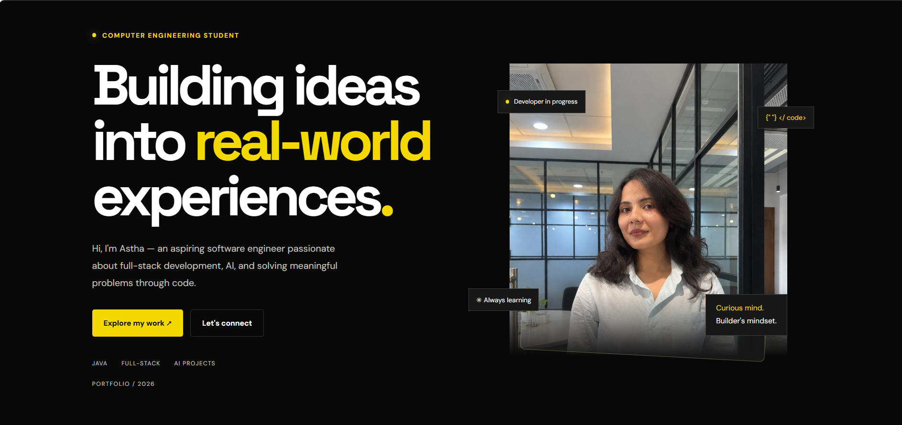
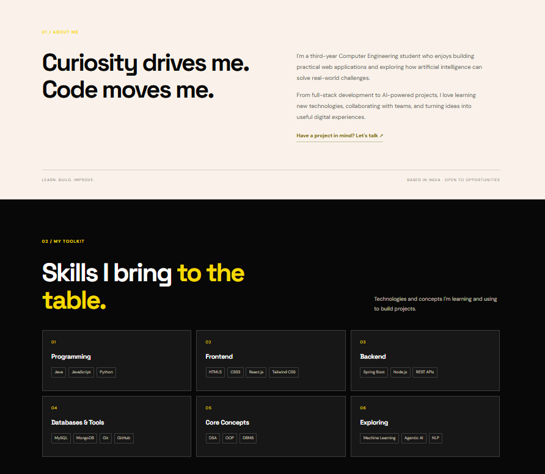
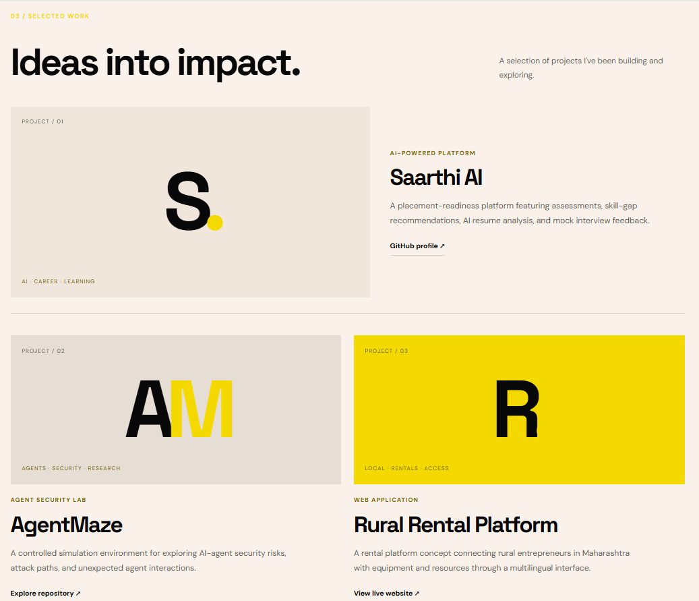
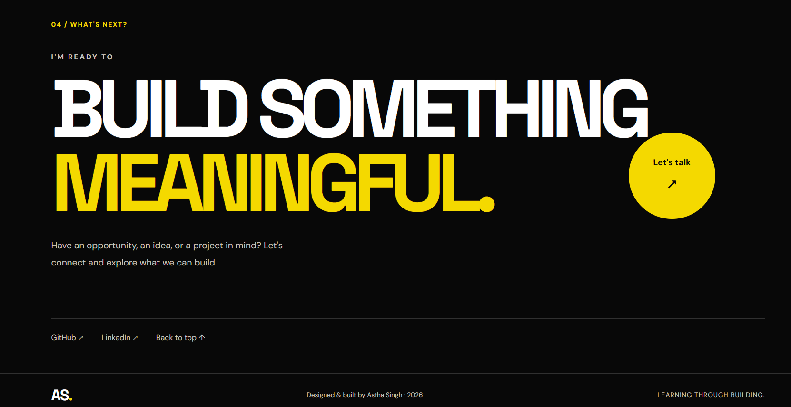

# ASTHA SINGH | DEVELOPER PORTFOLIO

**Computer Engineering Student · Aspiring Software Engineer**

*Turning curiosity into code. Turning ideas into experiences.*

---

## 01 — Overview

A personal portfolio built to introduce my work, technical interests, and development journey through a focused digital experience.

Rather than functioning as a simple collection of links, this website brings together my background, technical toolkit, and selected projects in one place.

The portfolio reflects my current direction as a developer: exploring full-stack engineering, building practical applications, and understanding how AI can address real-world challenges.

**Live locally. Built with purpose. Designed around the work.**

## 02 — Visual Showcase

The interface uses a contrasting dark-and-light visual system, typography-led layouts, and structured content sections to create a consistent browsing experience.

|  |  |
|---|---|
| **01 / Introduction** | **02 / About & Toolkit** |
|  |  |
| **03 / Selected Work** | **04 / Contact** |
|  |  |

## 03 — Inside the Experience

| Section | Purpose |
|---|---|
| **Home** | Introduces my developer profile, interests, and personal identity. |
| **About** | Shares my academic background and approach to learning and building. |
| **Skills** | Organizes my technical toolkit into six distinct areas. |
| **Selected Work** | Presents projects that demonstrate my practical exploration. |
| **Contact** | Provides direct ways to connect professionally. |

## 04 — Technical Profile

The skills section presents my current learning and development toolkit.

| Domain | Technologies & Concepts |
|---|---|
| Programming | Java, JavaScript, Python |
| Frontend Engineering | HTML5, CSS3, React.js, Tailwind CSS |
| Backend Engineering | Spring Boot, Node.js, REST APIs |
| Data & Version Control | MySQL, MongoDB, Git, GitHub |
| Computer Science Fundamentals | Data Structures & Algorithms, OOP, DBMS |
| Emerging Technologies | Machine Learning, Agentic AI, NLP |

## 05 — Selected Work

The projects section highlights three areas of development and experimentation.

### 01. Saarthi AI
<text>**AI-POWERED PLACEMENT READINESS PLATFORM**</text>

A platform designed to help students prepare for placements through assessments, skill-gap recommendations, AI-powered resume analysis, and mock interview feedback.

[GitHub Profile](https://github.com/asthasingh18)

### 02. AgentMaze
<text>**AI AGENT SECURITY & SIMULATION**</text>

A controlled simulation environment exploring security risks, attack paths, and unexpected interactions between autonomous AI agents.

[Explore Repository](https://github.com/asthasingh18/AgentMaze)

### 03. Rural Rental Platform
<text>**WEB APPLICATION · RURAL ACCESSIBILITY**</text>

A platform concept connecting rural entrepreneurs in Maharashtra with equipment and resources through a multilingual interface.

[Visit Live Application](https://rental-app-five-tau.vercel.app/)

## 06 — Design Principles

The portfolio follows a few deliberate design choices:

- **Visual contrast:** Alternating dark and light sections establish clear content separation.
- **Content hierarchy:** Prominent headings and section labels guide visitors through the page.
- **Personal identity:** A portrait-led introduction makes the portfolio feel personal rather than template-driven.
- **Structured presentation:** Skills and projects are organized for quick scanning.
- **Accessible navigation:** Section-based navigation and direct contact links make important information easy to reach.
- **Responsive experience:** The layout and navigation are designed to support different screen sizes.

## 07 — Technology & Implementation

| Technology | Implementation |
|---|---|
| HTML5 | Semantic page structure and content sections |
| CSS3 | Layout, typography, styling, and responsive presentation |
| JavaScript | Navigation interaction |
 
The project uses a lightweight frontend setup without a framework or build-tool dependency.

## 08 — Repository Structure

```text
WebDev-L1-Portfolio/
│
├── index.html              # Portfolio structure
├── style.css               # Visual design and layout
├── script.js               # Interactive navigation
├── astha.jpeg              # Profile portrait
├── README.md               # Project documentation
│
└── screenshots/
    ├── 01-hero.png
    ├── 02-about-skills.png
    ├── 03-projects.png
    └── 04-contact.png
```

## 09 — Run the Project

**Requirements:** A modern web browser and Git.

Clone the internship repository:

```bash
git clone https://github.com/asthasingh18/OIBSIP.git
```

Navigate to the project:

```bash
cd OIBSIP/WebDev-L1-Portfolio
```

Launch `index.html` in your browser.

No dependency installation or build process is required.

## 10 — Project Information

| Detail | Information |
|---|---|
| Project | Personal Developer Portfolio |
| Internship | Oasis Infobyte |
| Track | Web Development & Design |
| Level | Level 1 |
| Task | Portfolio Website |
| Development | HTML, CSS, JavaScript |

---

## LET'S CONNECT

**Interested in technology, meaningful projects, and continuous learning.**

- **GitHub:** [asthasingh18](https://github.com/asthasingh18)
- **LinkedIn:** [Astha Singh](https://www.linkedin.com/in/astha-singh-tech/)
- **Email:** [asthaasingh232@gmail.com](mailto:asthaasingh232@gmail.com)

---

<p align="center">
  <b>BUILD WITH CURIOSITY. GROW WITH EVERY PROJECT.</b>
  <br>
  <sub>Astha Singh · Developer Portfolio · 2026</sub>
</p>