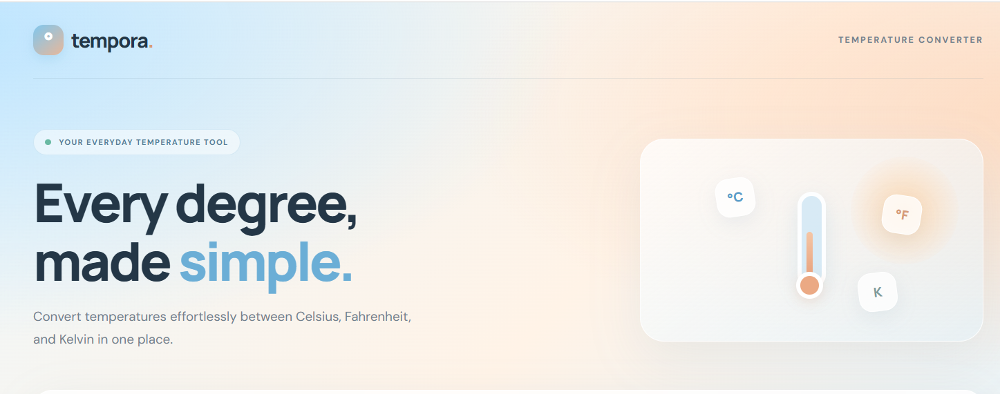
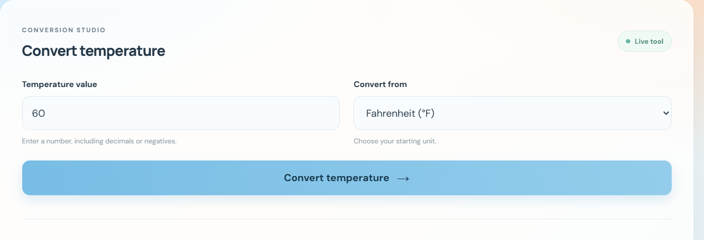
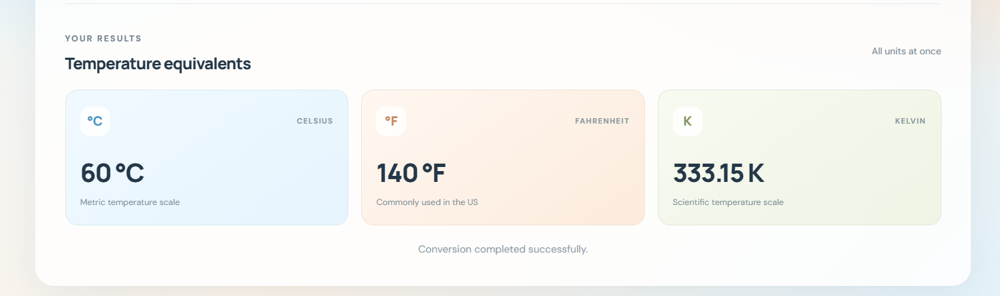

# TEMPORA — Every Degree, Made Simple.

<p align="center">
  A thoughtfully designed temperature conversion experience.
</p>

<p align="center">
  <strong>Celsius · Fahrenheit · Kelvin</strong>
</p>

---

## 01 — The Concept

**Tempora** is a responsive temperature conversion application built to make everyday temperature calculations simple, intuitive, and reliable.

Instead of presenting conversion as just a mathematical operation, Tempora brings together a clean interface, straightforward interactions, and accurate conversion logic in one focused experience.

Users can enter a temperature in their preferred unit and instantly view its equivalent values in Celsius, Fahrenheit, and Kelvin.

## 02 — A Look Inside Tempora

The interface follows a minimal visual direction, keeping the conversion experience at the centre of attention.

### Interface Overview



### Conversion Results

Enter a value such as **25°C** to view its corresponding values across all three temperature scales.



### Input Validation

Tempora checks temperature values against the scientifically defined lower limit of each scale, preventing physically invalid temperatures below absolute zero.



## 03 — What Makes It Work

| Feature | Implementation |
|---|---|
| Three temperature scales | Celsius, Fahrenheit, Kelvin |
| Multi-unit conversion | Displays all three equivalent values |
| Input validation | Checks empty and invalid numeric inputs |
| Absolute-zero validation | Rejects temperatures below the physical limit |
| Result formatting | Displays values up to two decimal places |
| Responsive interface | Structured for different screen sizes |
| Accessible feedback | Uses live regions and validation messages |

## 04 — The Conversion Logic

All conversions use Celsius as the common reference point. This keeps the calculation process consistent regardless of the selected input unit.

**Fahrenheit to Celsius**

\[
°C = (°F - 32) \times \frac{5}{9}
\]

**Kelvin to Celsius**

\[
°C = K - 273.15
\]

**Celsius to Fahrenheit**

\[
°F = (°C \times \frac{9}{5}) + 32
\]

**Celsius to Kelvin**

\[
K = °C + 273.15
\]

Once the input is converted to Celsius, the application calculates the corresponding Fahrenheit and Kelvin values.

## 05 — Accuracy Beyond the Formula

A reliable converter needs more than correct formulas. It also needs to handle invalid inputs and numerical edge cases.

Tempora includes:

- **Absolute-zero checks:** Enforces the minimum possible temperature of -273.15°C, -459.67°F, and 0 K.
- **Floating-point handling:** Uses a small tolerance to prevent precision errors near absolute zero.
- **Clean number formatting:** Limits displayed results to two decimal places.
- **Input validation:** Handles empty, non-numeric, and invalid temperature values.
- **Result reset:** Clears outdated results when validation fails.

These details help make the conversion experience more dependable.

## 06 — Technology Stack

- **HTML5** — Application structure and semantic elements.
- **CSS3** — Layout, visual styling, and responsive presentation.
- **JavaScript (Vanilla)** — Conversion calculations, input validation, and dynamic result updates.

No external conversion API or JavaScript framework is required.

## 07 — Project Structure

```text
WebDev-L1-TemperatureConverter/
│
├── index.html
├── style.css
├── script.js
├── README.md
│
└── screenshots/
    ├── 01-tempora-overview.png
    ├── 02-conversion-results.png
    └── 03-validation.png
```

## 08 — Run Locally

Get started with Tempora in a few simple steps:

1. Clone the repository:

   ```bash
   git clone https://github.com/asthasingh18/OIBSIP.git
   ```

2. Navigate to the project directory:

   ```bash
   cd OIBSIP/WebDev-L1-TemperatureConverter
   ```

3. Open `index.html` in your preferred browser.

No additional installation or configuration is needed.

## 09 — What I Explored

Building Tempora provided an opportunity to work with JavaScript beyond basic DOM interactions.

Key areas explored during development:

- Implementing mathematical conversion formulas.
- Managing form submissions and user input.
- Handling edge cases in numerical calculations.
- Applying scientific constraints through validation.
- Presenting dynamic results through DOM manipulation.
- Improving usability through accessible feedback.

## 10 — Internship Context

**Oasis Infobyte — Web Development & Design Internship**

This project was developed as part of the Level 1 task series, applying fundamental frontend development concepts to a practical, interactive web application.

---

<p align="center">
  <strong>TEMPORA</strong><br>
  Every degree, made simple.
</p>

<p align="center">
  Designed and developed by <a href="https://github.com/asthasingh18">Astha Singh</a>
</p>