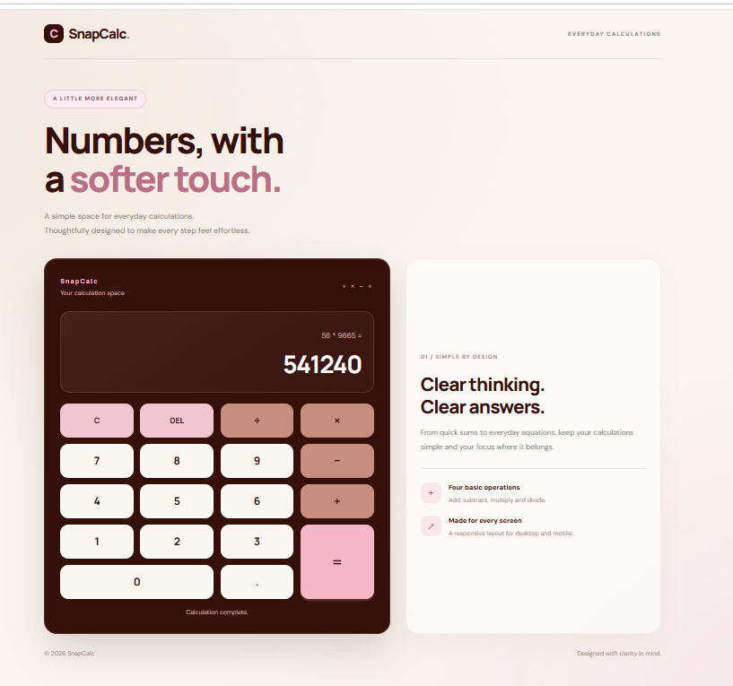
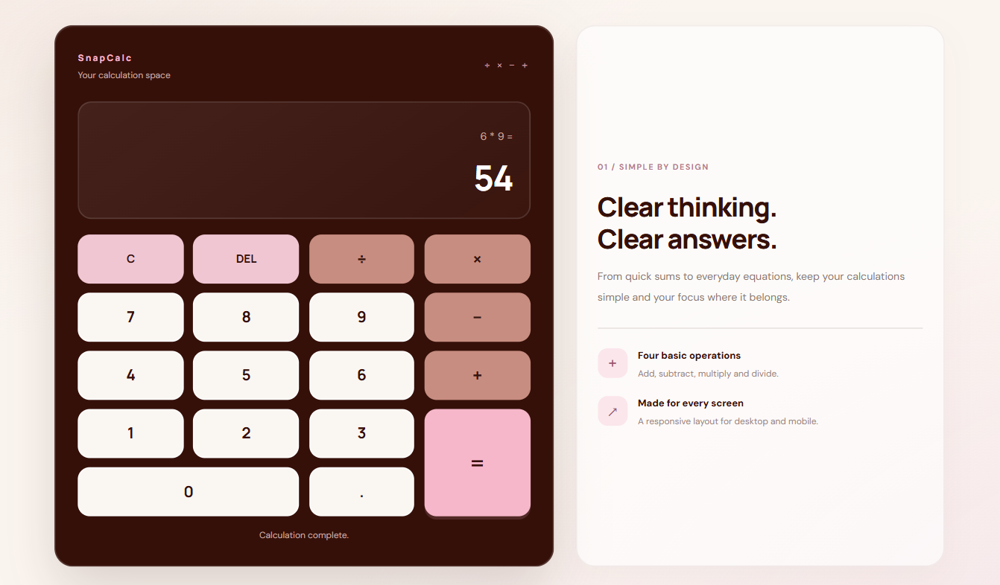
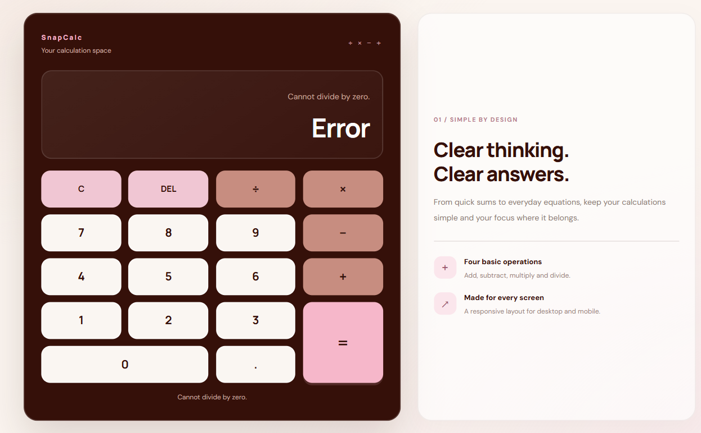

# SNAPCALC — Arithmetic, Refined.

A thoughtfully designed calculator that brings simplicity and precision together. **SnapCalc** combines a warm, minimal interface with a custom JavaScript calculation engine to make everyday arithmetic feel effortless.

Built as part of the **Oasis Infobyte Web Development and Design Internship — Level 2, Task 4**.

## Preview

### 01. The Interface
A clean, distraction-free calculator experience with a complementary information panel.



### 02. Calculation in Action
Evaluates chained arithmetic expressions while respecting mathematical operator precedence.



### 03. Input Validation
Provides clear feedback when an invalid mathematical operation, such as division by zero, is attempted.



## Design Philosophy

SnapCalc follows a simple principle: **functionality should feel as good as it works.**

- **Warm visual identity:** An ivory background paired with deep brown, soft pink, and terracotta accents.
- **Purposeful typography:** DM Sans and Manrope create a balanced, modern appearance.
- **Focused layout:** A calculator interface complemented by a compact information panel.
- **Responsive experience:** The layout adapts across desktop, tablet, and mobile screen sizes.
- **Thoughtful interactions:** Hover, active, and keyboard-focus states improve usability.

## Core Features

- **Four Arithmetic Operations:** Addition, subtraction, multiplication, and division.
- **Operator Precedence:** Evaluates multiplication and division before addition and subtraction.
- **Decimal Calculations:** Supports decimal number input.
- **Unary Operators:** Handles positive and negative values.
- **Clear and Delete:** Reset the calculation or remove the most recently entered character.
- **Expression Display:** Shows the current mathematical expression alongside its result.
- **Input Validation:** Handles malformed expressions, incomplete calculations, and division by zero.
- **Precision Handling:** Formats calculated results and manages floating-point precision.
- **Negative Zero Handling:** Prevents confusing negative-zero output.

## Under the Hood

One of SnapCalc's key implementation decisions is its **custom expression evaluator**.

Instead of relying on JavaScript's `eval()`, the calculator uses a structured evaluation approach:

1. **Tokenization:** Converts the mathematical expression into numbers and operators.
2. **Operator Precedence:** Uses a precedence map to determine the correct evaluation order.
3. **Stack-Based Evaluation:** Uses value and operator stacks to process the expression.
4. **Result Formatting:** Validates and formats the final numerical result.

This approach provides greater control over expression processing and error handling.

## Technology Stack

| Technology | Purpose |
|---|---|
| HTML5 | Semantic structure and calculator interface |
| CSS3 | Styling, layout, animations, and responsiveness |
| JavaScript | Input handling and calculation logic |
| CSS Grid | Structured calculator keypad |
| Google Fonts | DM Sans and Manrope typography |

## Project Structure

```text
WebDev-L2-Calculator/
│
├── index.html
├── style.css
├── script.js
├── README.md
│
└── screenshots/
    ├── 01-snapcalc-overview.png
    ├── 02-calculation-result.png
    └── 03-validation.png
```

## Run Locally

No installation or additional dependencies are required.

1. Clone the repository:

   ```bash
   git clone https://github.com/asthasingh18/OIBSIP.git
   ```

2. Navigate to the project directory:

   ```bash
   cd OIBSIP/WebDev-L2-Calculator
   ```

3. Open `index.html` in your preferred web browser.

## Learning Outcomes

Developing SnapCalc strengthened my understanding of:

- DOM manipulation and event delegation.
- JavaScript expression parsing and evaluation.
- Stack-based algorithms and operator precedence.
- Input validation and edge-case handling.
- Responsive CSS layouts and accessibility considerations.
- Separating application structure, styling, and logic.

## Internship Details

**Program:** Oasis Infobyte — Web Development and Design Internship  
**Level:** Level 2  
**Task:** Task 4 — Calculator  
**Project:** SnapCalc

---

*Designed with simplicity. Built with logic. Refined through code.*