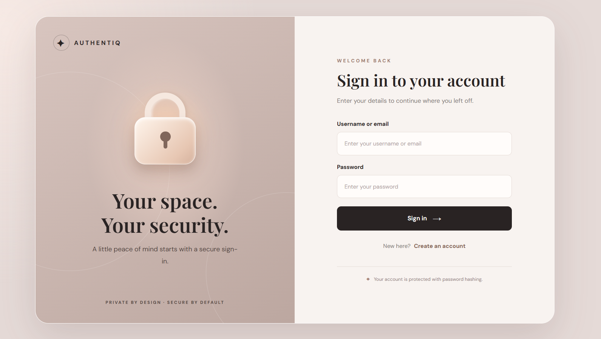
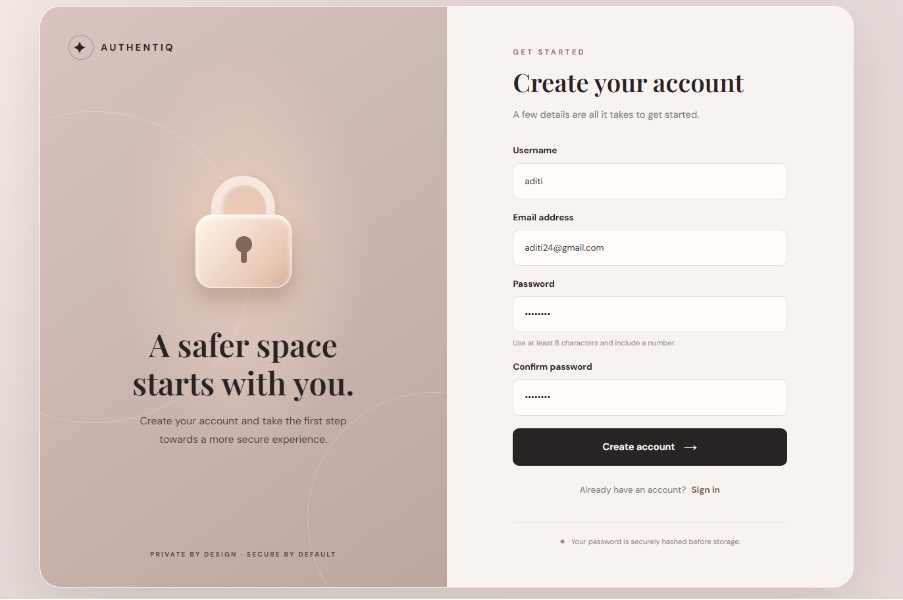
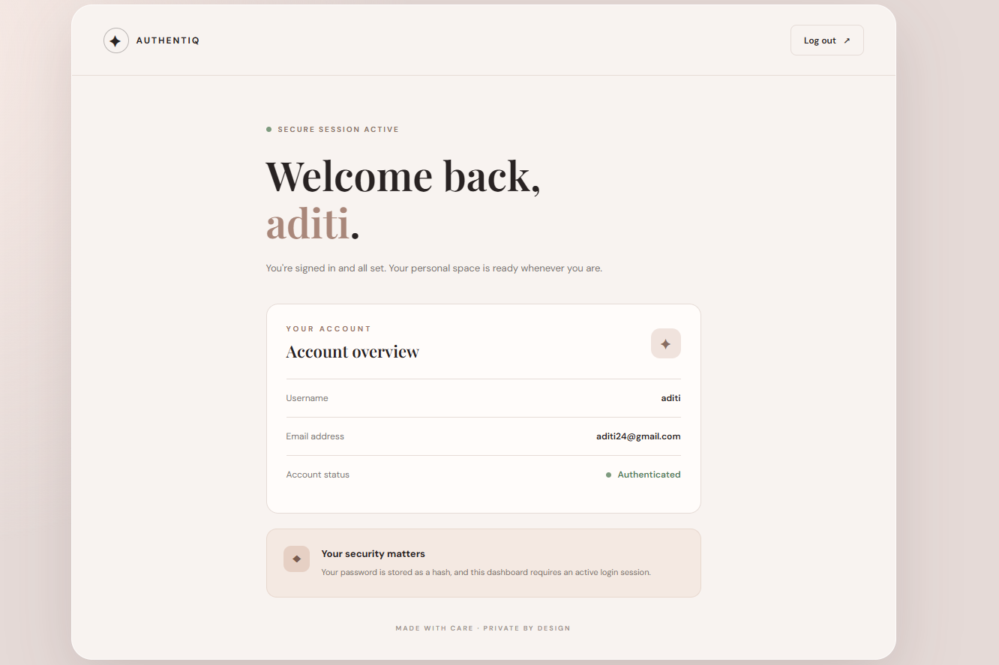
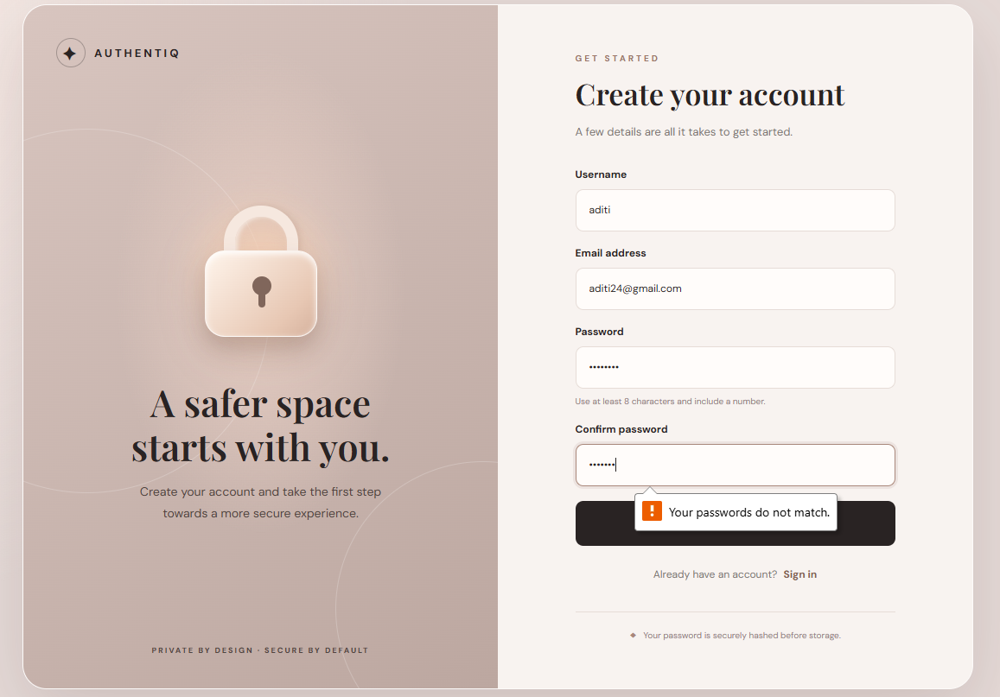

# AUTHENTIQ — Private by Design. Secure by Default.

A Flask-based user authentication web application featuring account registration, secure password hashing, login validation, session-based authentication, and a personalized dashboard.

## Screenshots

### 1. Login Page


### 2. Account Registration


### 3. User Dashboard


### 4. Form Validation


## Features

- **User Registration:** Create an account using a username, email, and password.
- **Secure Password Storage:** Passwords are hashed using Werkzeug before being stored in SQLite.
- **Login Authentication:** Sign in using either a registered username or email.
- **Input Validation:** Checks required fields, password length, numeric character requirements, and password confirmation.
- **Duplicate Account Prevention:** Prevents duplicate usernames and email addresses.
- **Session Management:** Uses Flask sessions to maintain authenticated users.
- **Protected Dashboard:** Restricts dashboard access to authenticated users.
- **Logout:** Securely clears the current session through a POST request.
- **Responsive Interface:** Custom CSS styling for desktop, tablet, and mobile layouts.

## Technology Stack

| Technology | Purpose |
|---|---|
| Python | Backend programming |
| Flask | Web framework |
| SQLite | User data storage |
| HTML5 | Page structure |
| CSS3 | Styling and responsive layouts |
| JavaScript | Client-side form validation |
| Werkzeug | Password hashing and verification |

## Authentication Flow

1. A new user submits the registration form.
2. The backend validates the submitted information.
3. The password is hashed before storage in SQLite.
4. After successful registration, an authenticated session is created.
5. Existing users can log in using their username or email.
6. The protected dashboard displays the authenticated user's account information.
7. Logging out clears the session and returns the user to the login page.

## Project Structure

```text
WebDev-L2-LoginAuthentication/
│
├── app.py
├── users.db                 # Generated locally
│
├── templates/
│   ├── login.html
│   ├── register.html
│   └── dashboard.html
│
├── static/
│   ├── css/
│   │   └── style.css
│   ├── js/
│   │   └── script.js
│   └── images/
│
├── screenshots/
│   ├── 01-authentiq-login.png
│   ├── 02-authentiq-registration.png
│   ├── 03-authentiq-dashboard.png
│   └── 04-authentiq-validation.png
│
└── README.md
```

## Run Locally

### 1. Clone the repository

```bash
git clone https://github.com/asthasingh18/OIBSIP.git
```

### 2. Navigate to the project directory

```bash
cd OIBSIP/WebDev-L2-LoginAuthentication
```

### 3. Create a virtual environment

```bash
python -m venv venv
```

### 4. Activate the virtual environment

**Windows PowerShell:**

```powershell
.\venv\Scripts\Activate.ps1
```

### 5. Install dependencies

```bash
pip install Flask
```

### 6. Start the application

```bash
python app.py
```

### 7. Open in your browser

```text
http://127.0.0.1:5000/
```

The SQLite database and users table are initialized automatically when the application starts.

## Security Notes

- Passwords are stored as hashes, not plaintext.
- SQL queries use parameterized statements.
- Dashboard routes require an authenticated session.
- Session cookies use `HttpOnly` and `SameSite=Lax` settings.
- For production deployment, configure a strong secret key using the `SECRET_KEY` environment variable and disable Flask debug mode.

## Project Information

**Internship:** Oasis Infobyte — Web Development and Design

**Project:** Level 2 — Login Authentication

**Application:** AUTHENTIQ

---

*Built as part of the Oasis Infobyte Web Development Internship.*