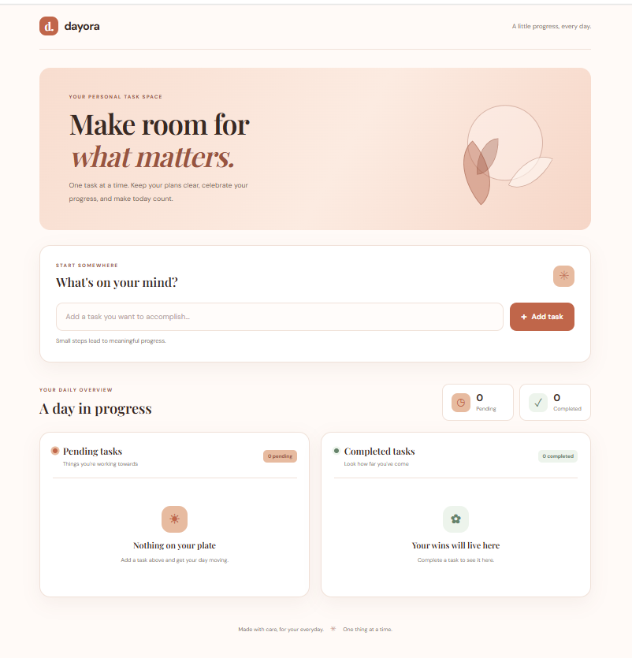
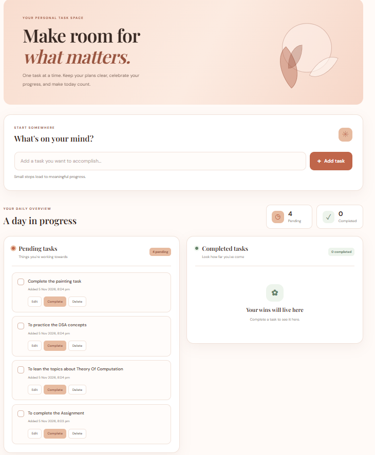
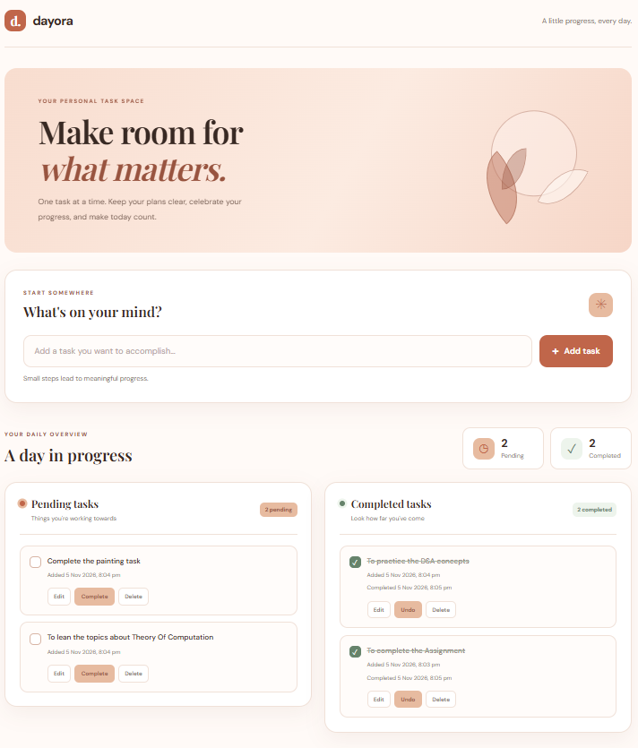
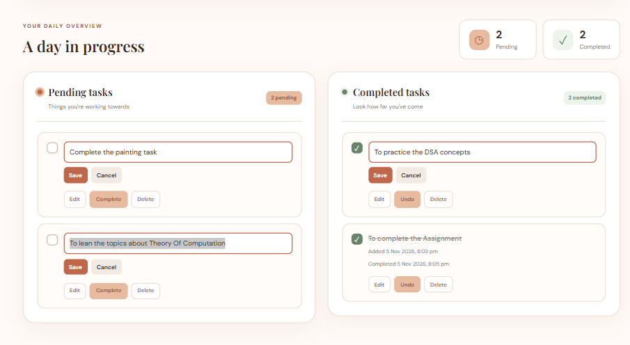

# DAYORA — Daily Task Planner

DAYORA is a simple and responsive daily task planner designed to help users organize their everyday activities, track progress, and manage tasks efficiently.

## Features

- **Add Tasks:** Create tasks with input validation.
- **Edit Tasks:** Update existing task descriptions.
- **Mark as Completed:** Move tasks between pending and completed sections.
- **Undo Completion:** Restore completed tasks to the pending list.
- **Delete Tasks:** Remove tasks when they are no longer needed.
- **Progress Tracking:** View pending and completed task counts.
- **Persistent Storage:** Tasks are saved using browser localStorage and remain available after refreshing the page.
- **Responsive Design:** Layout adapts to desktop and mobile screen sizes.

## Screenshots

### 1. Application Overview


### 2. Pending Tasks


### 3. Completed Tasks


### 4. Edit Task


## Technologies Used

- HTML5
- CSS3
- JavaScript
- Browser localStorage
- Google Fonts

## Project Structure

```text
WebDev-L2-TodoApp/
│
├── index.html
├── style.css
├── script.js
├── README.md
│
└── screenshots/
    ├── 01-dayora-overview.png
    ├── 02-dayora-pending-tasks.png
    ├── 03-dayora-completed-tasks.png
    └── 04-dayora-task-edit.png
```

## How to Run Locally

1. Clone the repository.
2. Navigate to the `WebDev-L2-TodoApp` folder.
3. Open `index.html` in your web browser.
4. Start adding and managing your daily tasks.

No backend setup or database installation is required.

## Data Storage

DAYORA uses browser localStorage to save task information. Data remains available in the same browser on the same device unless the browser's stored site data is cleared. It does not use cloud synchronization.

## Internship

Developed as part of the **Oasis Infobyte Web Development and Designing Internship — Level 2**.

---

**DAYORA — A little progress, every day.**