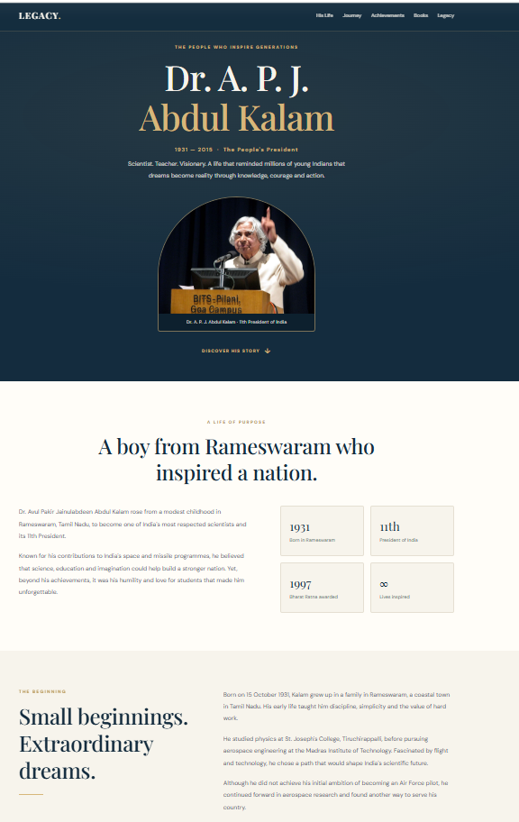
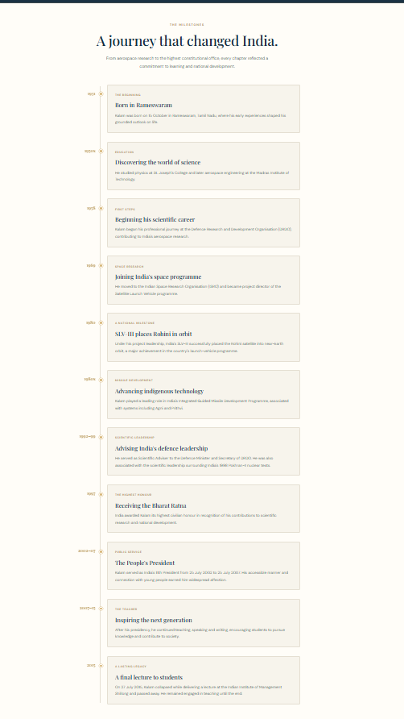
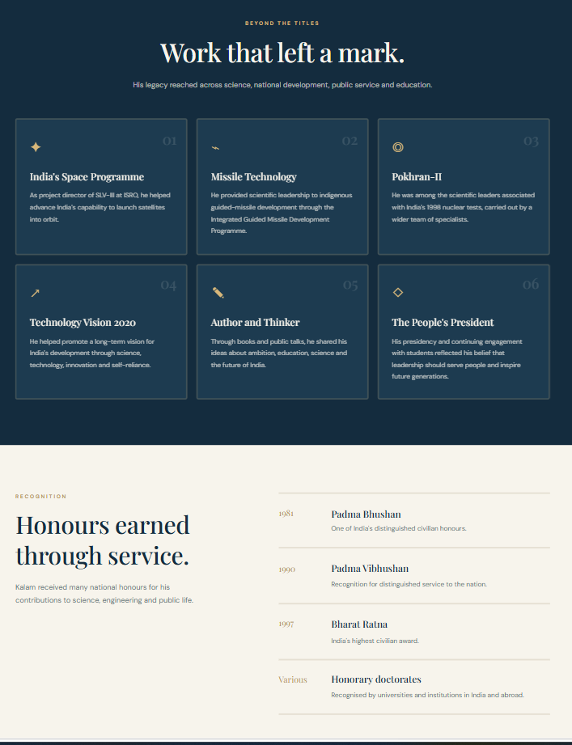
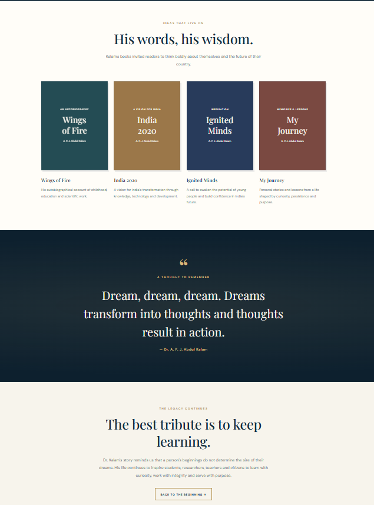

# Dr. A. P. J. Abdul Kalam | A Legacy of Dreams

<p align="center">
  <strong>A tribute to the life, vision, and enduring legacy of India's Missile Man.</strong>
</p>

<p align="center">
  A thoughtfully designed, responsive webpage celebrating the journey of Dr. A. P. J. Abdul Kalam — scientist, educator, author, and the 11th President of India.
</p>

---

## About the Project

**A Legacy of Dreams** is a tribute website that brings together the defining moments of Dr. A. P. J. Abdul Kalam's life, from his early beginnings in Rameswaram to his remarkable contributions to India's scientific and educational landscape.

The experience follows an editorial-inspired visual approach, combining refined typography, a navy-and-gold colour palette, and structured storytelling to present his journey in an engaging and accessible format.

## Highlights

- **A Life in Focus** — An introduction to his background, vision, and contributions.
- **The Journey** — A chronological timeline of significant milestones.
- **Scientific Contributions** — Highlights of his work in India's space and missile programmes.
- **Recognition & Honours** — A look at the awards and distinctions he received.
- **Words & Wisdom** — Selected publications and an inspirational quote.
- **A Lasting Legacy** — A reflection on his influence on future generations.
- **Responsive Experience** — Layouts adapted for desktop, tablet, and mobile screens.
- **Intuitive Navigation** — Section-based navigation with smooth scrolling.

## Design & Technology

| Area | Implementation |
|---|---|
| Structure | HTML5 |
| Styling | CSS3 |
| Typography | Google Fonts — DM Sans & Playfair Display |
| Layout | CSS Grid and Flexbox |
| Responsiveness | CSS Media Queries |

**Visual direction:** Deep navy, warm ivory, and subtle gold accents create a calm, timeless presentation inspired by editorial design.

## Project Structure

```text
WebDev-L2-TributePage/
│
├── index.html
├── style.css
├── README.md
│
└── screenshots/
    ├── 01-tribute-overview.png
    ├── 02-tribute-journey.png
    ├── 03-tribute-achievements.png
    └── 04-tribute-books-legacy.png
```

## Visual Preview

### 01 — The Introduction
The opening section introduces Dr. Kalam through a portrait, a concise profile, and the central theme of the tribute.



### 02 — The Journey
A chronological presentation of the important milestones that shaped his life and career.



### 03 — Achievements & Recognition
An overview of his scientific contributions and the honours that recognised his service to the nation.



### 04 — Books & Legacy
A closing reflection on his writings, ideas, and the inspiration he continues to offer.



## Getting Started

Run the project locally:

1. Clone the repository.
2. Navigate to the `WebDev-L2-TributePage` directory.
3. Open `index.html` in a modern web browser.

No build tools, frameworks, or package installations are required.

## Project Details

- **Internship:** Oasis Infobyte — Web Development and Designing
- **Level:** Level 2
- **Project:** Tribute Page
- **Type:** Responsive Frontend Web Project

---

<p align="center">
  <em>"Dream, dream, dream. Dreams transform into thoughts and thoughts result in action."</em>
  <br/>
  <strong>— Dr. A. P. J. Abdul Kalam</strong>
</p>