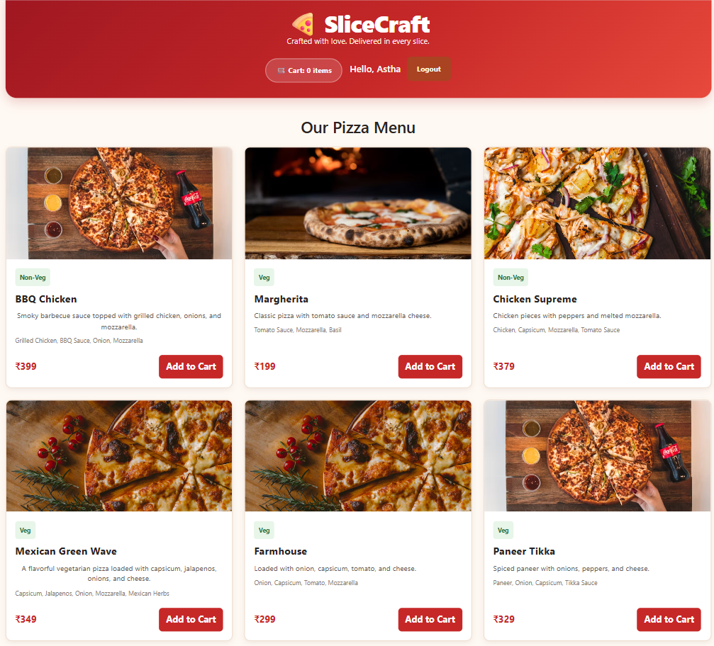
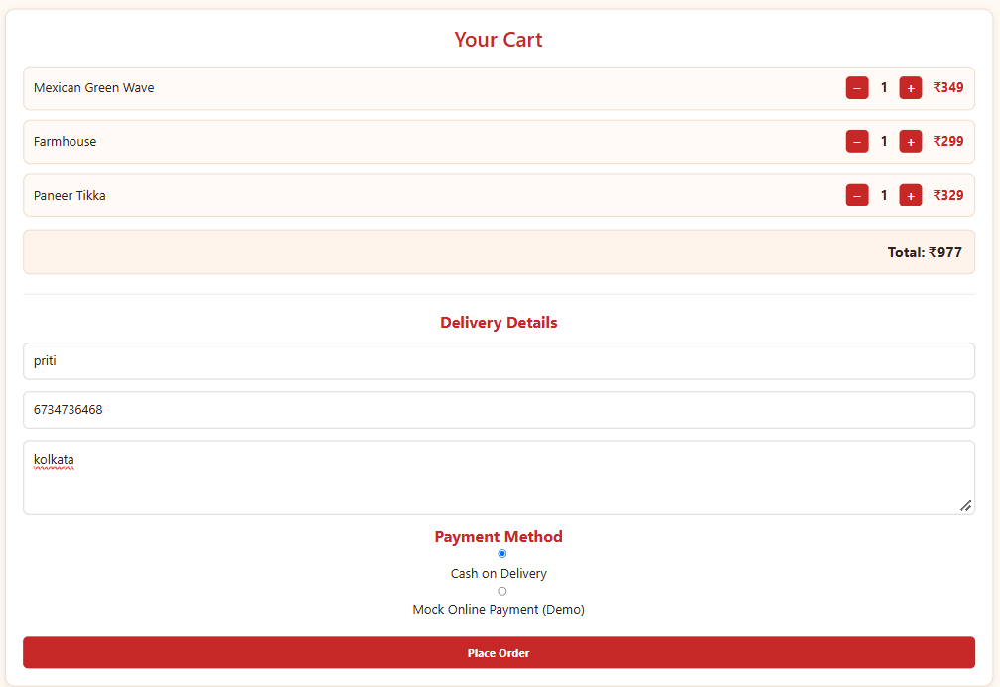
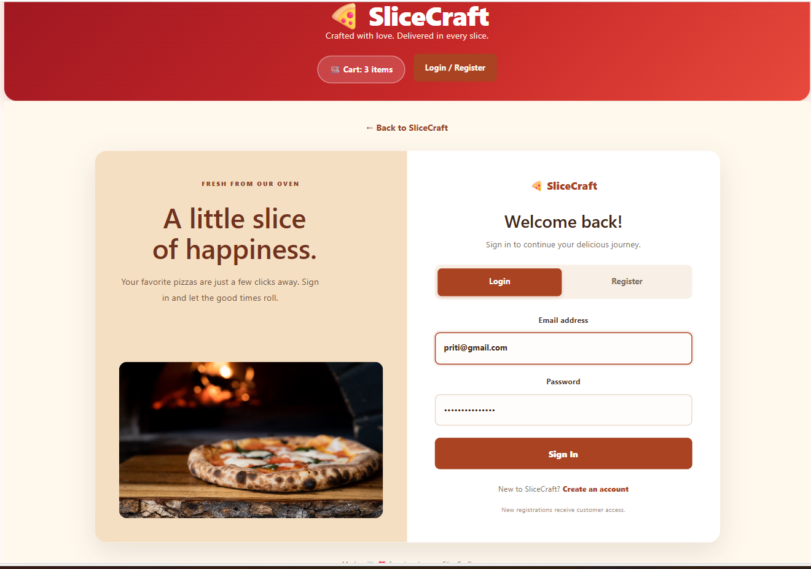
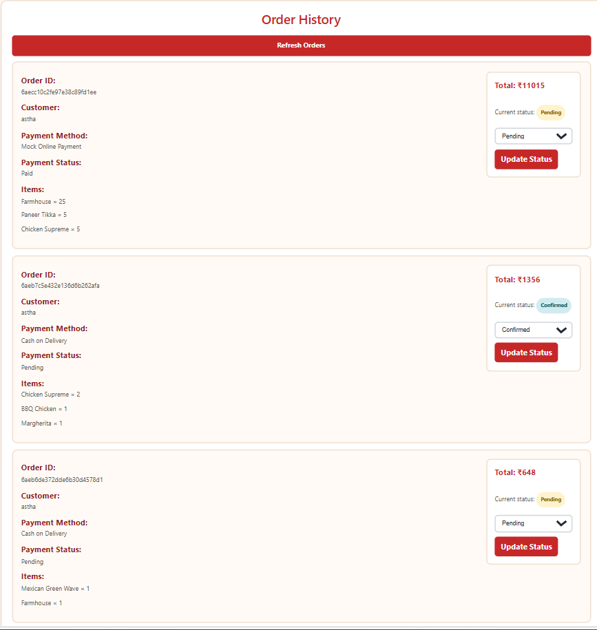
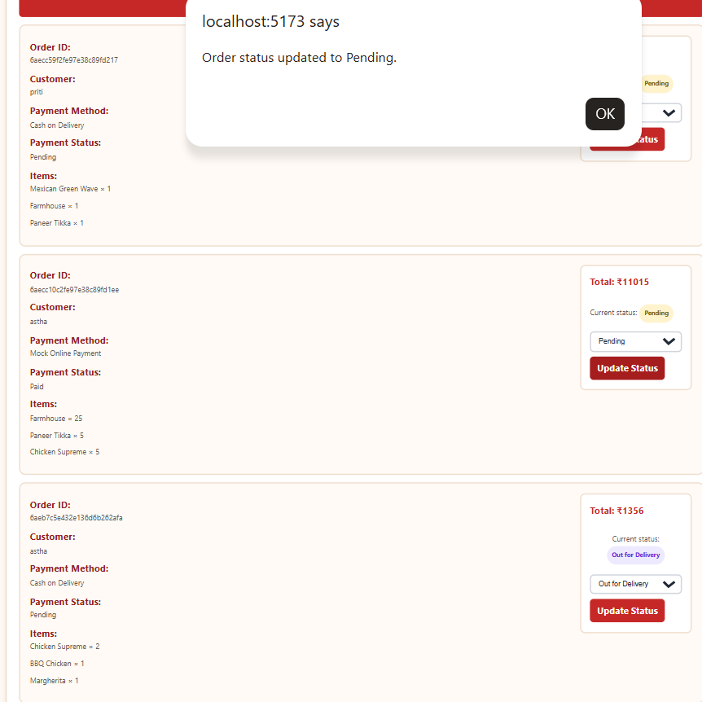
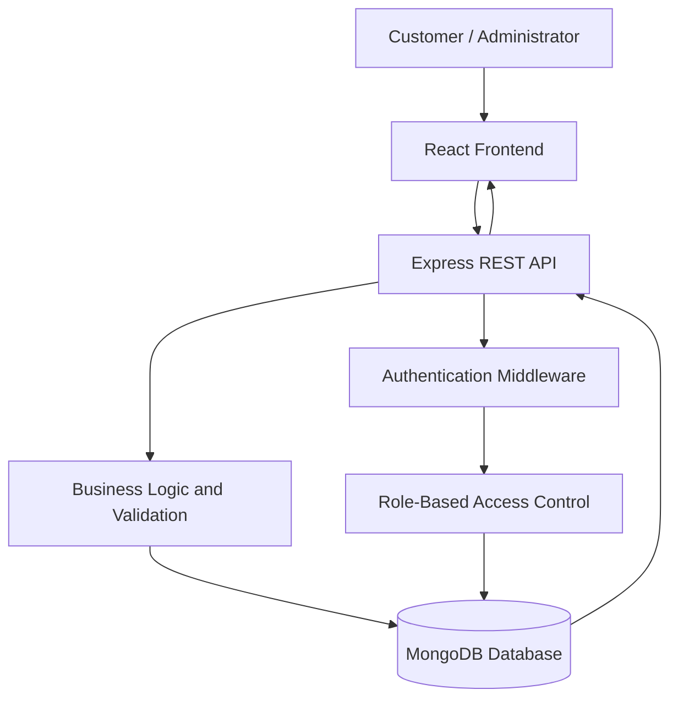

# 🍕 SliceCraft
### Your Cravings. Our Craft. Delivered.

**A full-stack pizza ordering and management platform built with React, Node.js, Express, and MongoDB.**

SliceCraft brings the pizza ordering experience into one streamlined application. Customers can explore the menu, customize their cart, place orders, and track their order history, while administrators manage incoming orders and control their progress through a dedicated interface.

<p align="center">
  
</p>

---

## ✨ What Makes SliceCraft?

SliceCraft is designed around two distinct experiences: a convenient customer ordering journey and an organized administrative workflow.

| Customer Experience | Admin Experience |
|---|---|
| Explore the pizza menu | View customer orders |
| Add and manage cart items | Manage order statuses |
| Secure registration and login | Access role-protected functionality |
| COD and simulated online payment | Monitor the order lifecycle |
| View personal order history | Manage incoming orders |

## 📸 Application Preview

<details>
<summary><strong>01 — Menu & Discovery</strong></summary>
<br>

Explore the available pizza menu, categories, descriptions, and pricing.
</details>

<details>
<summary><strong>02 — Cart & Checkout</strong></summary>
<br>

Manage selected items, quantities, order totals, and checkout details.
</details>

<details>
<summary><strong>03 — Authentication</strong></summary>
<br>

Customer registration and login with secure authentication.
</details>

<details>
<summary><strong>04 — Customer Order History</strong></summary>
<br>

Access previously placed orders and view their current statuses.
</details>

<details>
<summary><strong>05 — Admin Order Management</strong></summary>
<br>

Manage customer orders and update their progress through the delivery lifecycle.
</details>

---

## 🚀 Core Capabilities

### 🛒 Smart Ordering Experience
- Dynamic pizza menu retrieved from the backend.
- Add, remove, and adjust cart quantities.
- Automatic order total calculation.
- Checkout with customer and delivery information.
- Support for Cash on Delivery and simulated online payment.

### 🔐 Authentication & Access Control
- Customer registration and login.
- Password hashing using bcrypt.
- JWT-based authentication.
- Protected API routes.
- Role-based authorization for customer and admin operations.

### 📦 Order Management
- Place orders using validated server-side data.
- Retrieve customer-specific order history.
- Store payment method and payment status.
- Track order progress through multiple statuses.
- Restrict administrative status updates to authorized admins.

### ⚙️ Backend Validation
- Validate customer and delivery information.
- Verify pizza availability before accepting orders.
- Calculate order totals using database prices.
- Validate order quantities and payment methods.
- Enforce ownership and administrative permissions.

---

## 🧰 Technology Stack

| Category | Technologies |
|---|---|
| Frontend | React.js, Vite |
| Styling | CSS |
| Backend | Node.js, Express.js |
| Database | MongoDB, Mongoose |
| Authentication | JSON Web Tokens, bcryptjs |
| Development Tools | VS Code, npm, Git, GitHub |

---

## 🏗️ Application Architecture

SliceCraft follows a client-server architecture. The React frontend communicates with the Express REST API, which handles authentication, business logic, validation, and database operations.



### Project Structure

```text
WebDev-L3-PizzaDelivery/
│
├── backend/
│   ├── config/          # Database configuration
│   ├── middleware/     # Authentication and authorization
│   ├── models/         # MongoDB schemas
│   ├── routes/         # REST API endpoints
│   ├── scripts/        # Database seed and admin setup
│   ├── server.js       # Express application entry point
│   └── package.json
│
├── frontend/
│   ├── public/
│   ├── src/
│   │   ├── App.jsx
│   │   ├── App.css
│   │   ├── index.css
│   │   └── main.jsx
│   └── package.json
│
├── screenshots/
│   ├── home.png
│   ├── cart-checkout.png
│   ├── authentication.png
│   ├── customer-orders.png
│   └── admin-dashboard.png
│
└── README.md
```

---

## 💻 Getting Started

Follow these instructions to run SliceCraft locally.

### Prerequisites

- Node.js and npm
- MongoDB database
- Git

### 1. Clone the Repository

```bash
git clone https://github.com/asthasingh18/OIBSIP.git
cd OIBSIP/WebDev-L3-PizzaDelivery
```

### 2. Configure the Backend

```bash
cd backend
npm install
```

Create a `.env` file inside the `backend` directory:

```env
PORT=5000
MONGODB_URI=your_mongodb_connection_string
JWT_SECRET=your_jwt_secret
ADMIN_NAME=your_admin_name
ADMIN_EMAIL=your_admin_email
ADMIN_PASSWORD=your_admin_password
```

Replace the placeholders with your own configuration. Keep `.env` private and never commit credentials.

### 3. Initialize Database Records

Insert the sample pizza menu:

```bash
node scripts/seedPizzas.js
```

Create an administrator account:

```bash
node scripts/createAdmin.js
```

**Important:** The pizza seed script clears existing pizza records before inserting the sample menu. Run it only when you intend to reset that collection.

### 4. Start the Backend Server

```bash
node server.js
```

Backend URL: `http://localhost:5000`

### 5. Run the Frontend

Open a separate terminal:

```bash
cd frontend
npm install
npm run dev
```

Open the local development URL displayed by Vite.

The frontend API base URL is configured as `http://localhost:5000/api`.

---

## 🔌 REST API Reference

Base URL: `http://localhost:5000/api`

| Method | Endpoint | Purpose |
|---|---|---|
| GET | `/health` | Check backend health |
| GET | `/pizzas` | Retrieve available pizzas |
| POST | `/auth/register` | Register a customer |
| POST | `/auth/login` | Authenticate a user |
| GET | `/auth/me` | Retrieve current user |
| POST | `/orders` | Create an order |
| GET | `/orders` | Retrieve authorized order history |
| POST | `/orders/:id/mock-payment` | Simulate online payment |
| PATCH | `/orders/:id/status` | Update order status (admin only) |

Protected endpoints require a valid JWT. Administrative operations require the appropriate role.

---

## 💳 Payment Implementation

SliceCraft supports two payment methods:

- **Cash on Delivery:** Orders can be placed with COD.
- **Online Payment (Demo):** A simulated payment endpoint updates the payment status for demonstration.

> **Note:** The online payment workflow is a mock implementation. It does not process real transactions or charge customers.

---

## 🧪 Verification

The following development checks were performed:

| Check | Result |
|---|---|
| Frontend production build | Successful |
| Frontend lint | Zero errors; one non-blocking warning |
| Customer registration and login | Verified |
| Cart and checkout workflow | Verified |
| COD order placement | Verified |
| Simulated online payment | Verified |
| Customer order history | Verified |
| Admin order management | Verified |

---

## 🎓 Project Context

**Internship:** Oasis Infobyte — Web Development and Designing Internship  
**Level:** Level 3  
**Project:** Pizza Delivery Web Application

This project provided practical experience in full-stack application development, REST API design, database integration, authentication, authorization, and end-to-end feature verification.

---

## 👩‍💻 Developer

**Astha Singh**  
Computer Engineering Student | Full-Stack Development Enthusiast

[GitHub Profile](https://github.com/asthasingh18)

---

<p align="center">
  <strong>SliceCraft — Crafted for cravings. Built for convenience. 🍕</strong>
</p>